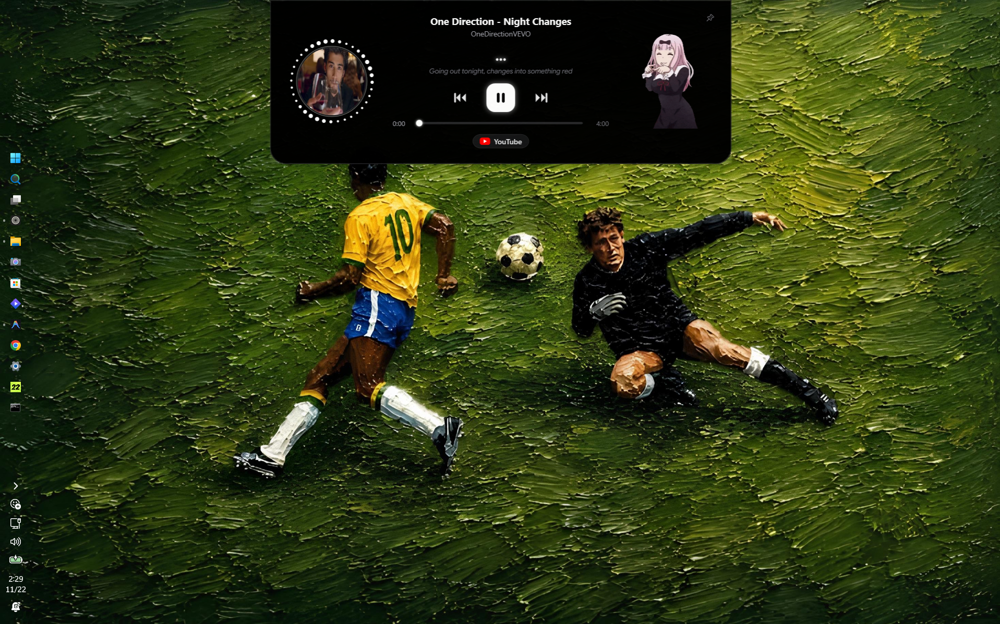

<div align="center">

# lysyn

**Dynamic Island notch widget with real-time synced lyrics, reactive visualizer, and animated companions for Windows.**

---

[](https://dotnet.microsoft.com/)
[](https://microsoft.com/windows)
[](https://github.com)
[](LICENSE)

</div>

<br/>

## 🌟 Overview

**lysyn** brings the modern dynamic island experience to Windows. Discreetly anchored to the top of your screen, it automatically detects any media playing across your system (Spotify, YouTube, YouTube Music, Apple Music, browsers, and media players) to deliver word-by-word synchronized lyrics, media controls, an audio-reactive visualizer ring, and animated companions.

<br/>

## 📸 Screenshots



<br/>


<br/>

## ✨ Key Features

### 🎵 Real-Time Synced Lyrics
- Powered by LRCLIB API with instant local JSON caching for zero-latency repeats.
- Smart track & artist normalization: automatically cleans noise from YouTube video titles (e.g. `Official Video`, `VEVO`, `Topic`, `Live`, `Extended`, `Remastered`) to match lyrics accurately.

### ⚪ Zero-Gradient Solid Theming
- Strict zero-gradient aesthetic: clean, distraction-free solid color styling throughout.
- **Default Theme**: Solid White (`#F4F4F5` / `#FFFFFF`).
- **9 Solid Presets**: Red, Orange, Yellow, Green, Cyan, Blue, Purple, Pink, and White.
- Full 0–360° Hue slider with live dynamic recoloring across the island and settings.

### 🔤 Google Sans Typography
- Crisp, modern typography tuned for legibility at a glance.
- Font picker supporting any system font family and adjustable font sizing.

### 💫 Audio-Reactive Circular Visualizer
- Concentric pulsing audio ring wrapping your active media's album art.
- Visualizer nodes strictly synchronize with your chosen accent theme color.

### 🎀 Animated Character Companions
- High-framerate animated GIF companion positioned on the right edge of the notch.
- **Default Companion**: **Chika** (`Assets/chika.gif`).
- Built-in presets: Chika, Arisu, Cat, and Bunny with custom file import, horizontal flip, and playback speed control.

### 🖥️ Dynamic Island Geometry
- Pinned smoothly to your screen's top center.
- **Hover Expansion**: Expands into full player view on mouse hover; snaps back cleanly when unfocused.
- **Pin Mode**: Lock the island permanently expanded when desired.

<br/>

## 📥 Installation

### Option 1: Standalone Executable Installer (Recommended 🌟)
1. Download or open `dist/lysyn-setup.exe`.
2. Double-click the installer.
3. Select your shortcut preferences and click **Install lysyn**.
4. The installer automatically extracts files to `%LOCALAPPDATA%\Programs\lysyn`, registers Desktop & Start Menu shortcuts, and launches the app.

> **Silent Installation**: Run `lysyn-setup.exe /S` for unattended deployment.

<br/>

### Option 2: PowerShell One-Click Setup
Open PowerShell in the project directory and run:
```powershell
powershell -ExecutionPolicy Bypass -File .\Install-lysyn.ps1
```

<br/>

### Option 3: Portable Archive
Extract `dist/lysyn-v1.0.0-windows-x64.zip` to any folder and launch `lysyn.exe`.

<br/>

## ⌨️ Global Shortcuts & Controls

| Shortcut / Action | Function |
| :--- | :--- |
| `Ctrl + Alt + L` | Toggle notch visibility on/off |
| `Ctrl + Alt + C` | Toggle click-through mode (transparent to mouse clicks) |
| **Hover Notch** | Expands the island into full media & lyrics view |
| **Right-Click Notch** | Opens context menu (Settings, Resync Media, Exit) |
| **Click Play / Pause** | Toggles playback in active media app |
| **Click Timeline Bar** | Scrubs audio position directly |

<br/>

## ⚙️ Settings Dashboard

Right-click the notch or system tray icon and select **Settings** to access the widescreen dashboard:

- **🎨 Theme & Colors**: Choose solid presets or adjust the 0–360° Hue slider with live preview.
- **✨ GIF Companion**: Select character presets (Chika, Arisu, Cat, Bunny), flip horizontally, or change speed.
- **🖥️ Notch & Display**: Customize width (240–600px), height (32–90px), recenter button, and hover-expand toggles.
- **🎵 Lyrics & Timing**: Select typography (Google Sans), adjust timing offsets (±50ms up to ±3000ms), and purge cached lyrics.
- **⚙️ Integration**: Configure run-at-startup, always-on-top, click-through, and global hotkeys.

<br/>

## 🏪 Microsoft Store Publishing

Looking to distribute **lysyn** on the official Microsoft Store? Follow the step-by-step checklist in the [Microsoft Store Guide](MICROSOFT_STORE_GUIDE.md). All required tile assets (`StoreLogo.png`, `Square150x150Logo.png`, etc.) and the `Package.appxmanifest` template are pre-generated in `Assets/Store/`.

<br/>

## 🏗️ Building from Source

### Prerequisites
- Windows 10 / 11 (64-bit)
- [.NET 9.0 SDK](https://dotnet.microsoft.com/download/dotnet/9.0)

### Build & Package
Open PowerShell in the repository root:
```powershell
# 1. Run unit tests
dotnet test

# 2. Package release, payload, and standalone installer
.\build-package.ps1
```

Build outputs will be generated in `dist/`:
- `dist/lysyn-setup.exe` — Standalone Single-File Windows Executable Installer
- `dist/lysyn-v1.0.0-windows-x64.zip` — Portable Release Archive
- `dist/lysyn/` — Extracted application binaries and assets

<br/>

## 📄 License

Distributed under the MIT License. See `LICENSE` for details.
